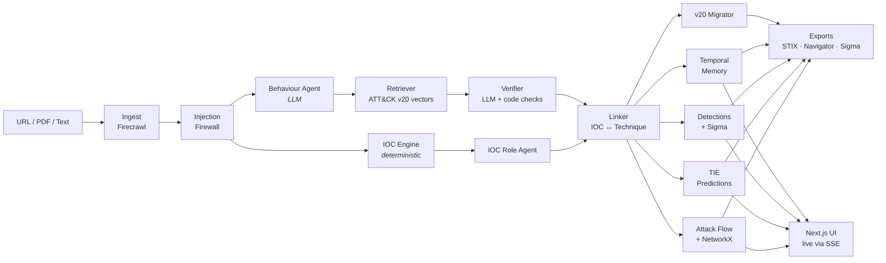

<div align="center">

# 🔱 TRINETRA

### The threat intelligence platform that won't hallucinate.

**Paste any threat report → get verified IOCs, evidence-backed MITRE ATT&CK® v20 techniques, the attack story, and a defence plan — in under a minute.**

[](https://attack.mitre.org/resources/updates/)
[](https://oasis-open.github.io/cti-documentation/)
[](https://www.python.org/)
[](https://nextjs.org/)
[](https://fastapi.tiangolo.com/)
[](LICENSE)

[**Live Demo**](#) · [**Demo Video**](#) · [**Docs**](PLAN.md) · [**Report a Bug**](../../issues)

<!-- Replace with a real GIF of the pipeline canvas + attack flow building -->


*Built by Team **WeBugz** for Vyuham'26 Agent Forge · Problem AF-15 · Cybersecurity & Digital Trust*

</div>

---

## ⚡ TL;DR

Security teams drown in threat reports. Each one hides IOCs in prose (often defanged like `hxxp://evil[.]com`) and describes attacker behaviour that must be mapped to MITRE ATT&CK by hand — slow, inconsistent and error-prone. Plain LLMs make it worse: they invent technique IDs and confuse similar techniques.

**TRINETRA** turns a report into structured, *verifiable* intelligence:

- 🎯 **Every technique comes with the exact quote that proves it** — click and it's highlighted in the source.
- 🛡️ **A verifier rejects hallucinations** — IDs not in ATT&CK v20 or quotes not in the report never reach you.
- 🧠 **It remembers** — IOCs and actors connect across reports, and conflicting claims are flagged.
- 🔧 **It ends in action** — attack paths you can break, detection gaps you can close, Sigma rules you can deploy.

---

## ✨ Features

<table>
<tr>
<td width="50%" valign="top">

### 🔍 Defang-aware IOC engine
Extracts IPs, domains, URLs, hashes, emails, CVEs, file paths and registry keys — including defanged indicators. Filters out private IPs, version numbers and benign domains, then labels each IOC's **role** (C2, payload, phishing, exfil) with evidence.

</td>
<td width="50%" valign="top">

### 🎯 Evidence-grounded ATT&CK mapping
Report → atomic behaviours with exact quotes → semantic retrieval over ATT&CK **v20** → LLM verifier against official descriptions → hard code checks. Rejected candidates are shown with reasons. Full transparency.

</td>
</tr>
<tr>
<td valign="top">

### 🕸️ Live agent pipeline
Watch every agent run in real time on a visual workflow canvas — deterministic steps and LLM steps clearly badged, each streaming its output.

</td>
<td valign="top">

### 🧬 Auto attack flow
Rebuilds the attack as an animated causal chain. **Observed** steps are solid, **predicted** steps (MITRE CTID Technique Inference Engine) are ghost nodes to hunt for, and **unknown** gaps are marked honestly.

</td>
</tr>
<tr>
<td valign="top">

### 💥 Attack disruption simulator
Block any step and instantly see what percentage of attack paths break, which survive, and which D3FEND countermeasures apply.

</td>
<td valign="top">

### 📡 Detection readiness
Maps each technique to ATT&CK v20 Detection Strategies, Analytics and log sources. Tick the telemetry you have — see your gaps. Generates **pySigma-validated** Sigma rules.

</td>
</tr>
<tr>
<td valign="top">

### 🧠 Temporal threat memory
Every report enriches a temporal knowledge graph. Get alerts like *"this C2 IP appeared in 2 earlier reports"* and contradiction cards when sources disagree. Replay with a time slider.

</td>
<td valign="top">

### 🧱 Prompt-injection firewall
Threat reports are untrusted input. TRINETRA detects poisoned reports that try to manipulate the AI and maps the attempt to ATT&CK v20 **T1698 / T1699**.

</td>
</tr>
<tr>
<td valign="top">

### 🔄 v20 taxonomy migrator
Old reports cite retired IDs (e.g. Defense Evasion, split in v19 into Stealth and Defense Impairment). TRINETRA remaps them to current ATT&CK automatically.

</td>
<td valign="top">

### 📊 Accuracy scoreboard
Measured, not claimed: precision / recall / F1 against CISA advisories' published ATT&CK tables, compared with a plain-LLM baseline.

</td>
</tr>
</table>

### 📤 Standards-native exports
`STIX 2.1 bundle` · `ATT&CK Navigator layer` · `Attack Flow JSON` · `Sigma rules (→ KQL / SPL)` · `PDF report`

---

## 🖼️ Screenshots

<!-- Replace with real screenshots before submission -->
| Pipeline canvas | Evidence view | Attack flow |
|:---:|:---:|:---:|
|  |  |  |

| Detection readiness | Memory graph | Scoreboard |
|:---:|:---:|:---:|
|  |  |  |

---

## 🏗️ Architecture



**Design principles**
1. **No hallucinated output reaches the user.** IDs must exist in ATT&CK v20; quotes must exist in the source.
2. **Deterministic first.** Code handles what code can; the LLM handles language understanding.
3. **Verified output is the only writer to memory.** No second LLM re-extracts raw text into the graph.
4. **Observed ≠ predicted.** Inferences are always visually and structurally separate from facts.
5. **Untrusted input stays data.** Report content is never treated as instructions.

---

## 🧰 Tech Stack

| Layer | Technology |
|---|---|
| **Frontend** | Next.js · TypeScript · Tailwind · shadcn/ui · Framer Motion · React Flow · sigma.js / graphology · deck.gl + MapLibre |
| **Backend** | Python · FastAPI · LangGraph · Pydantic v2 · Server-Sent Events |
| **AI / ML** | LLM via LiteLLM (provider-agnostic) · fastembed (`bge-small-en-v1.5`) · CTID Technique Inference Engine |
| **Security data** | MITRE ATT&CK v20 (STIX) · mitreattack-python · D3FEND · Attack Flow 3 · iocsearcher · stix2 · pySigma |
| **Data** | PostgreSQL + pgvector · NetworkX |
| **Integrations** | Firecrawl · n8n (alerts, MISP / OpenCTI push) |
| **Deploy** | Docker Compose · Vercel · Railway / Render |

---

## 🚀 Quick Start

### Prerequisites
- Docker & Docker Compose
- An LLM API key (any LiteLLM-supported provider)
- A Firecrawl API key (optional — falls back to local parsing)

### 1. Clone and configure
```bash
git clone https://github.com/webugz/trinetra.git
cd trinetra
cp .env.example .env   # add your keys
```

### 2. Launch
```bash
docker compose up --build
```

### 3. Load ATT&CK v20 and build embeddings (first run only)
```bash
docker compose exec backend python scripts/load_attack.py
```

### 4. Open
- **App:** http://localhost:3000
- **API docs:** http://localhost:8000/docs

<details>
<summary><b>⚙️ Environment variables</b></summary>

| Variable | Description |
|---|---|
| `LLM_API_KEY` | Key for your LLM provider |
| `LLM_EXTRACT_MODEL` | Stronger model for behaviour extraction |
| `LLM_VERIFY_MODEL` | Faster model for verification |
| `FIRECRAWL_API_KEY` | Firecrawl key for URL/PDF ingestion |
| `DATABASE_URL` | Postgres connection string |
| `MAPPING_CONFIDENCE_THRESHOLD` | Minimum verifier confidence (default `0.6`) |
| `N8N_WEBHOOK_URL` | Optional — outbound alerts |

</details>

<details>
<summary><b>🛠️ Local development without Docker</b></summary>

```bash
# backend
cd backend
python -m venv .venv && source .venv/bin/activate
pip install -r requirements.txt
uvicorn app.main:app --reload

# frontend
cd frontend
npm install
npm run dev
```
</details>

---

## 📖 Usage

**In the app:** paste a report URL, upload a PDF, or paste text → watch the pipeline run → explore evidence, flow, detections and memory → export.

**Via API:**
```bash
# start an analysis
curl -X POST http://localhost:8000/api/analyses \
  -H "Content-Type: application/json" \
  -d '{"url": "https://www.cisa.gov/news-events/cybersecurity-advisories/<advisory>"}'

# stream live pipeline events
curl -N http://localhost:8000/api/analyses/<id>/events

# export STIX 2.1
curl http://localhost:8000/api/analyses/<id>/export/stix -o report.stix.json
```

<details>
<summary><b>📚 API reference</b></summary>

| Method | Endpoint | Description |
|---|---|---|
| `POST` | `/api/analyses` | Start analysis (`url`, `text`, or PDF upload) |
| `GET` | `/api/analyses/{id}` | Full analysis result |
| `GET` | `/api/analyses/{id}/events` | Live SSE pipeline stream |
| `POST` | `/api/analyses/{id}/feedback` | Analyst accept / reject |
| `POST` | `/api/analyses/{id}/simulate` | Attack disruption simulation |
| `POST` | `/api/analyses/{id}/readiness` | Detection gap analysis |
| `GET` | `/api/analyses/{id}/export/{fmt}` | `stix` · `navigator` · `sigma` · `flow` · `pdf` |
| `GET` | `/api/graph?at=<date>` | Temporal memory graph |
| `GET` | `/api/eval` | Accuracy scoreboard |

Interactive docs at `/docs`.
</details>

---

## 📊 Evaluation

Ground truth: CISA joint advisories that publish their own ATT&CK technique tables.

<!-- Fill from `python scripts/run_eval.py` — never hand-edit numbers -->
| System | Precision | Recall | F1 | Avg. time / report |
|---|:---:|:---:|:---:|:---:|
| Plain LLM baseline | — | — | — | — |
| **TRINETRA** | **—** | **—** | **—** | **—** |

Reproduce:
```bash
docker compose exec backend python scripts/run_eval.py
```

---

## 🗺️ Roadmap

- [x] Defang-aware IOC extraction with role labelling
- [x] Evidence-grounded ATT&CK v20 mapping with verifier
- [x] Live agent pipeline view
- [x] Attack flow, predictions and disruption simulator
- [x] Detection readiness + Sigma generation
- [x] Temporal memory with contradiction alerts
- [x] STIX 2.1 and Navigator exports
- [ ] Autonomous intel watch (CISA, CERT-In, vendor blogs)
- [ ] Investigation copilot with cited answers
- [ ] MCP server for Claude / Cursor
- [ ] Self-improving classifier from analyst feedback
- [ ] Multi-tenant SaaS with SSO

<!-- Tick items only when they actually work in the deployed build -->

---

## 🔐 Security & Responsible Use

- IOCs are always displayed **defanged** and never auto-opened.
- Report content is treated as untrusted data; prompt-injection attempts are detected and flagged.
- Predicted techniques are hypotheses for hunting, **not** confirmed observations.
- Infrastructure overlap is never presented as proof of attribution.

Found a vulnerability? Please open a private security advisory rather than a public issue.

---

## 🤝 Contributing

Contributions are welcome! Please read [PLAN.md](PLAN.md) for architecture and data contracts, then:

1. Fork the repo and create a branch: `git checkout -b feat/amazing-feature`
2. Commit with clear messages
3. Make sure tests pass: `pytest` and `npm test`
4. Open a pull request

---

## 🙏 Acknowledgements

TRINETRA stands on the shoulders of the open threat-informed defence community:

- [MITRE ATT&CK®](https://attack.mitre.org/) and [D3FEND™](https://d3fend.mitre.org/)
- [MITRE Center for Threat-Informed Defense](https://ctid.mitre.org/) — TRAM, Technique Inference Engine, Attack Flow
- [OASIS CTI TC](https://github.com/oasis-open/cti-python-stix2) — STIX 2.1
- [SigmaHQ](https://github.com/SigmaHQ) — Sigma & pySigma
- [CTINexus](https://github.com/peng-gao-lab/CTINexus) — CTI knowledge graph research
- [iocsearcher](https://pypi.org/project/iocsearcher/) · [Firecrawl](https://github.com/firecrawl/firecrawl) · [LangGraph](https://github.com/langchain-ai/langgraph)

*MITRE ATT&CK and ATT&CK are registered trademarks of The MITRE Corporation. TRINETRA is not affiliated with or endorsed by MITRE.*

---

## 📄 License

Distributed under the Apache License 2.0. See [`LICENSE`](LICENSE) for details.

---

<div align="center">

**Built with ☕ and zero sleep by Team WeBugz**

If TRINETRA helped you, consider giving it a ⭐

</div>
